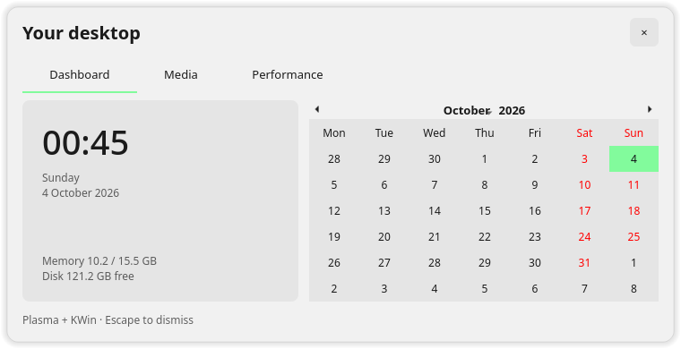
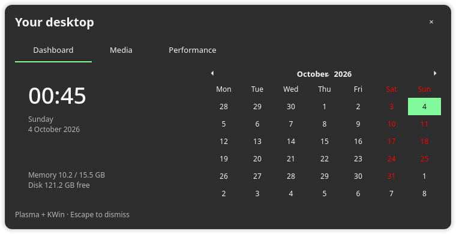

# KamaKiriStudio 0.5.0 development

**Development snapshot:** desktop-look switching is experimental. Crashes, duplicated controls and incomplete recovery have been reported. Use an isolated Plasma session for testing; see [KNOWN-ISSUES.md](KNOWN-ISSUES.md). The latest published release remains v0.4.1.

A native KDE desktop studio that keeps Plasma and KWin as its base. Inspired by Caelestia and Ryoku, with 22 official Omarchy color palettes, including Osaka Jade.

## Features

- Complete KDE color palettes, editable accents and panel placement, height and floating controls.
- A honeycomb gallery with 72 bundled theme wallpapers, excluding logo-only variants, credited “As seen in and inspired by Omarchy”, and a local wallpaper picker with optional matching colors.
- Monitor make/model and connector names, native KDE monitor identification and per-monitor primary-display controls. Primary changes apply immediately through KDE; appearance trials must finish first.
- Wallpaper placement on one display, the same image on the enabled displays, or one image spanning the KDE display arrangement.
- An installed KDE widget collection: clock, media player, CPU, memory, application dashboard, calendar, volume and network. Existing widgets are preserved and duplicate types are skipped.
- Data-only profile import and export. Import previews choices before applying them; desktop and panel targets stay local to this machine.
- About, manual GitHub release checks and an optional five-minute update monitor while the app is open. No automatic downloads or installations.

The launcher and dashboard now open as separate rounded, frameless popups, with optional compositor blur. **Reference rounded** uses larger corners inspired by the supplied desktop images. **Fluent inspired** uses tighter corners, neutral surfaces and lighter borders. Choose **Follow desktop**, **Light** or **Dark**. These are original Qt/KDE interfaces; they do not use Microsoft components or replace Plasma with Quickshell. Blur depends on the existing KWin blur effect; it is requested, never forced on. Popups close with Escape, their close button or focus moving to another application. KWin controls placement on Wayland.

In **Appearance → Advanced settings**, use **Popup look** and **Preview launcher/dashboard**. The **Slim left rail** panel preset selects a 40px floating panel and adds two native launch buttons. A **Floating bottom bar** preset is also available. These presets and popup-look changes turn off **Include KDE color changes** so your palette stays unchanged; you can enable it explicitly. Apply & try uses the existing Yes/No recovery flow for panel geometry, popup preferences and newly added panel buttons. Existing widgets are preserved. The panel itself uses your installed Plasma theme’s rounded floating shape.

The app launcher filters installed application metadata and opens the selected app through KDE’s ApplicationLauncherJob. Search input is never treated as a shell command. The popup dashboard has calendar, media and CPU/memory/disk/network pages. GPU, weather and audio visualizers are not included. The manager follows the KDE system theme independently of popup selection.

## Get started

Already using **KDE Plasma 6**? Download and extract the source archive, open a terminal in that folder, and run:

```sh
./install.sh
```

The guided installer handles dependencies on Debian/Ubuntu, Fedora/RHEL-family and Arch-family systems, builds for your machine, and adds the app to your Applications menu. It asks before installing; only the package manager uses administrator access. Desktop appearance stays unchanged. KDE 6 development packages must exist in your enabled repositories; older releases with only KDE 5 are unsupported. Arch dependency installation includes a full system upgrade.

Use `./install.sh --dry-run` to inspect the plan or `./install.sh --check` to check compatibility. See [the installation guide](docs/INSTALLATION.md). This development snapshot remains experimental.

### Manual build

Source checkouts must be built first. Release bundles include a locally built x86-64 binary; it is linked against Qt/KDE system libraries, not a universal AppImage. Other distributions should build against their own installed packages.

```sh
cmake -S . -B build -DCMAKE_BUILD_TYPE=Release
cmake --build build -j2
mkdir -p bin
cp build/kamakiri-studio bin/kamakiri-studio
python3 install-local.py
```

Open **KamaKiriStudio** from the Applications menu, or run `./launch.sh`. Use `./launch.sh --demo` for a preview that leaves appearance unchanged.

Requires C++17, CMake, Qt6 Widgets/DBus/Network/Test/QuickWidgets, KDE Frameworks 6 Config, IdleTime, Service, KIO and WindowSystem, libwayland-client development files, pkg-config and wayland-scanner. Runtime appearance changes require Plasma 6, `plasma-apply-colorscheme` and installed Breeze schemes. The manual local installer does not install dependencies or request root.

## Try changes and recover

Choose a palette in Appearance. Choose a local PNG, JPEG, WebP or BMP in **Appearance → Advanced settings**, optionally enable matching colors, select a desktop target and select widgets. **Apply & try** applies the choices from both pages together.

The confirmation has **Yes** and **No**, with an initial 15-second countdown that disappears after the first input. If there is no input for the first 15 seconds after changes finish applying, they revert. The click that started Apply is excluded. The first subsequent keyboard, pointer or touch input permanently removes the timeout for that trial. Yes keeps the changes; No or closing the confirmation restores them. You can test other windows with the confirmation open.

Before a trial, the worker checks the running Plasma process for stale or replaced Qt/KDE libraries and verifies that the app and Plasma use the same Qt runtime and plugin search environment. Isolated probes load native widget plugins and compile their QML imports for both the selected layout and the saved recovery layout, including system-tray subapplets. The probes do not add widgets to your desktop or instantiate their UI. Unknown, unreadable, timed-out or incompatible plugins block the operation with update, session-restart and repair guidance.

The same compatibility checks run after applying a trial, before keeping it, and before and after restoring settings. A failed recovery check preserves its snapshot and reports that package compatibility must be repaired first. Recovery restores configuration; it cannot restore Qt/KDE packages. These checks validate library and import compatibility, not every widget's behavior or dynamically loaded content.

An independent worker snapshots the settings before mutation. If the manager closes or its heartbeat stops for four seconds, the trial reverts. If the worker also crashes or the machine restarts, startup/login recovery restores abandoned trials. Recovery failures preserve snapshots and are reported; restoration cannot be guaranteed when Plasma or the original desktop/panel is unavailable.

Wallpaper trials support KDE’s **Image** wallpaper type. All-display and spanning choices target connected displays in the current activity; widgets still target the selected desktop. Spanning crops follow the arrangement in KDE Display Settings; reapply after changing that arrangement. Kept spanning crops remain in the private trial directory because Plasma uses those files. Reverting restores every affected wallpaper before removing the crops. Widgets added by the trial are marked with its transaction ID; rollback removes those widgets, leaving existing widgets alone. Kept widgets can be moved/resized using Plasma’s Edit Mode. Icons, authentication, login screen, lock screen, services and compositor remain unchanged.

Wayland activity monitoring requires version 2 of `ext_idle_notifier_v1`, using inhibitor-independent input notifications. It does not capture keys, text or pointer coordinates. Unsupported sessions refuse appearance changes. X11 uses KIdleTime but has not been live-tested here.

## Updates and privacy

**About and updates** checks public stable releases at `https://api.github.com/repos/TridentSpoon/KamaKiriStudio/releases/latest`. Monitoring is opt-in, runs only while the app is open, and sends an application User-Agent over HTTPS. No desktop settings, personal files or account tokens are sent. Updates are reviewed/downloaded manually from the official repository. Local build checks compare a bundled binary with its local SHA-256 manifest; this is a consistency check, not a signature or trust guarantee. A local check may be unavailable if the original build directory no longer exists.

Private trial records live in `${XDG_STATE_HOME:-~/.local/state}/kamakiri-studio`. Kept color schemes remain installed; reverted schemes are removed. Profiles contain local image paths when a wallpaper is selected; images are not embedded, so imported profiles need accessible local files.

The app does not run the reviewed Caelestia KDE installer, plugin store or remote configuration scripts. Only attributed Omarchy palette data is embedded. No password handling or privileged helper is used.

## Tests

```sh
ctest --test-dir build --output-on-failure
python3 tests/worker_integration.py build/kamakiri-studio
```

Tests cover trial decisions, hostile data, palette serialization, local image validation, widget ownership and simulated worker lifecycle. Live Plasma testing verified a wallpaper/widget trial and exact restoration of the original wallpaper, widget list and parsed color settings. See [VALIDATION.md](VALIDATION.md) for limits.

## Remove

Finish/revert any trial first. The installer owns these files:

- `~/.local/bin/kamakiri-studio`
- `~/.local/share/applications/kamakiri-studio.desktop`
- `~/.local/share/applications/kamakiri-launcher.desktop`
- `~/.local/share/applications/kamakiri-dashboard.desktop`
- `~/.config/autostart/kamakiri-studio-recovery.desktop`
- `~/.local/share/kamakiri-studio/installation.json`

Remove them to uninstall. Keep recovery records and kept schemes until you no longer need them. About/update preferences use the normal Qt application settings file.

## License

Original application code is MIT. Omarchy palette attribution and permission are in [OMARCHY-PALETTES.md](OMARCHY-PALETTES.md) and [OMARCHY-LICENSE](OMARCHY-LICENSE). The vendored Wayland protocol retains its upstream MIT notice. Breeze scheme notices are preserved at runtime. Qt/KDE/Wayland libraries come from installed system packages. This project is independent of KDE, Caelestia, Ryoku and Omarchy.

## Popup previews

| Fluent Light | Fluent Dark |
| --- | --- |
|  |  |

[Reference rounded launcher](docs/rounded-launcher.png). Screenshots show the app’s preview mode; launching applications is disabled in that mode.

The Studio manager follows the active KDE system colors, font and widget style. Rounded/Fluent popup choices affect the launcher and dashboard only.

Desktop look now includes **Default Plasma**, using native KDE Application Launcher and Breeze styling, and **Kamakiri style**, the independently developed rounded layout. Existing Caelestia identifiers remain internal for compatibility with saved profiles. These experimental look changes are pending recovery validation; no live appearance is applied by selecting a look.

**Update now** in About and updates checks the latest official stable GitHub release and installs only a newer version. It verifies the GitHub archive SHA-256 and release binary hash, checks that the binary runs, and uses the installed updater rather than downloaded scripts. Updates are blocked during unfinished appearance trials. A development build newer than the published release is retained. Restart the app after an update.

Appearance keeps the desktop look, theme preview, monitor switches, per-monitor panel position, wallpaper placement and gallery together. Detailed color, panel and popup settings are under **Advanced settings**. **Apply wallpaper** starts a wallpaper-only trial. Monitor switches scope wallpapers and panel changes; KDE colors and window styling remain session-wide. **None** removes secondary panels with recovery snapshots and is disabled on the primary monitor. Choosing a position on a monitor without a panel creates one, which No removes.

Appearance now includes wallpaper placement, theme galleries, local image selection and native Plasma widget choices. Each named theme offers five wallpapers, with the extra Retro 82, Tokyo Night and Catppuccin artwork retained. Catppuccin includes four additional Totoro scenes matching the first wallpaper’s navy, lavender and pastel pink colours. Catppuccin Latte’s studio wallpapers use the first image’s soft cream, peach, pink, lilac, mint and powder blue colours. Ethereal’s three studio choices are silhouette forest, nebula lake and planetary horizon scenes matching the original navy, blue, violet and peach-pink colours. Everforest’s studio wallpapers feature two wave scenes and two underwater kelp forests in the first wallpaper’s muted sage-grey and slate-green palette. Flexoki Light’s four studio wallpapers are restrained ink-on-warm-paper illustrations matching its first wallpaper. Use **Add your own wallpapers…** in **Wallpapers** to save images to the browsed wallpaper group. The group selector defaults to the current colours; choose another group to browse its wallpaper variants without changing your theme or palette. Images are copied into the app’s local data folder, deduplicated, and kept alongside bundled choices; adding an image only selects it for preview. **Apply wallpaper** starts the reversible trial. The headings are **Theme** for desktop layout and **Colours and wallpaper** for the palette preset. Additional local image and widget controls are under Advanced settings.

Fluent 10 and Fluent 11 place the native clock/calendar and Desktop Peek at the far right. KamaKiri Launcher and Dashboard panel shortcuts are exclusive to Kamakiri style. Existing unrelated widgets stay before the right-hand tray/clock section.

Appearance includes **Customise login screen…**, which opens KDE’s SDDM settings for login themes, backgrounds and supported appearance options. Missing SDDM settings receive installation guidance; the app does not install packages, switch display managers or restart the login service. KDE handles any required administrator authentication. These changes are separate from appearance-trial rollback.

**Customise Launcher / Start button…** opens the selected panel launcher’s native settings. KamaKiri Start offers a keyboard-accessible hexagon icon picker with Windows, the installed distribution logo, the original KDE logo, App grid, Menu, Computer, Launch and Home. The KDE logo comes from [KDE’s official clipart collection](https://kde.org/stuff/clipart/). It also supports a custom icon (including a local image through KDE’s icon chooser), resetting to its theme-default button, Kamakiri/Fluent menu styles and desktop/light/dark colours. Existing native KDE launchers open their own settings. Custom KamaKiri icons survive subsequent Kamakiri/Fluent layout changes and are covered by existing launcher configuration snapshots.

When Oxygen is the selected window decoration, colour trials match its active-window glow to the theme accent (including compatibility colours for older Oxygen versions). Glow colours and the accent-following setting are snapshotted and restored on rejection; inactive shadows, glow size and the enabled/disabled choice stay untouched. Kamakiri and Fluent looks retain an already-selected Oxygen decoration; Default Plasma still resets to Breeze. Oxygen’s settings are defined in [its upstream active-shadow configuration](https://github.com/KDE/oxygen/blob/master/liboxygen/oxygenactiveshadowconfigdata.kcfg). Other decorations keep their own shadow behaviour.

Kamakiri Style now defaults to a 42 px non-floating left rail. **Preview Kamakiri rail and rounded frame…** opens an isolated interactive layout with the current colours and wallpaper, adjustable rail width, frame thickness and corner radius. The preview never writes desktop settings or applies its sliders. The rounded desktop frame is a prototype at this stage; applying a look changes the native panel, not the desktop-wide frame. `kamakiri-studio --desktop-layout-preview` opens it independently; `--capture /path/preview.png` exports a screenshot.
